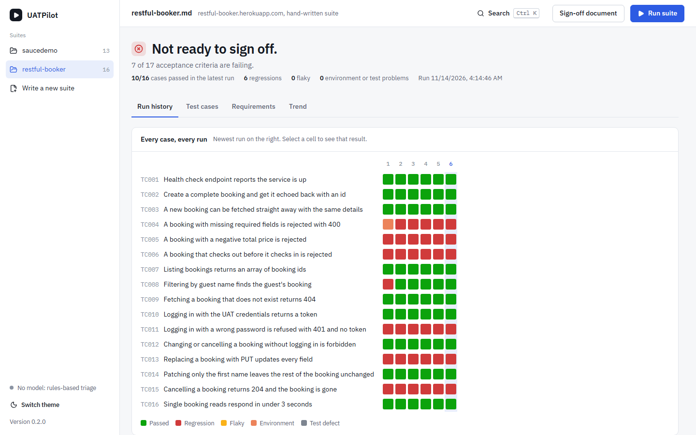
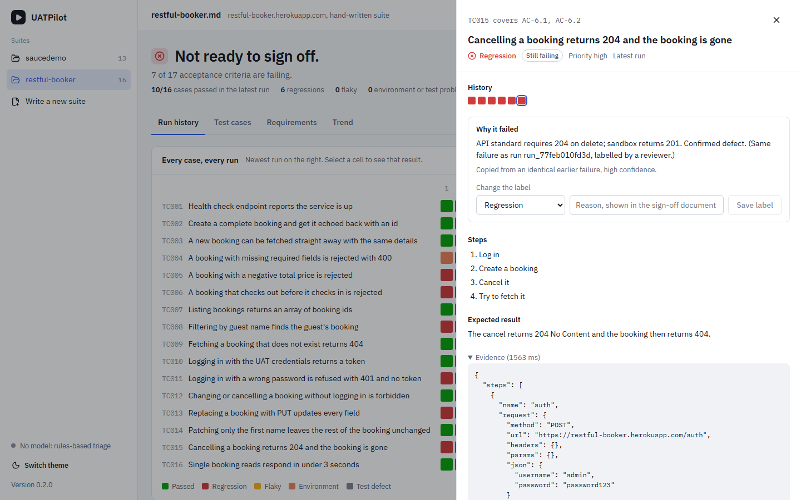
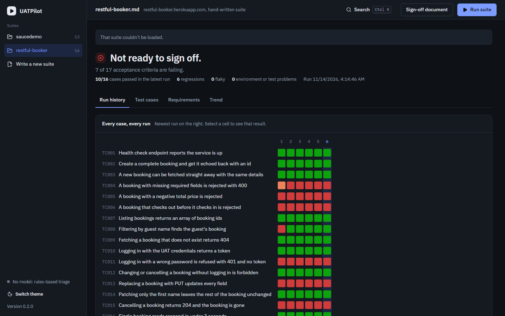

# UATPilot

**Requirements in, UAT test cases out: an agent writes the cases, they run for real, every
failure is triaged, and the results land on a dashboard with a sign-off document.**

Someone (often non-technical) writes requirements in prose. A junior analyst turns them into
structured UAT test cases, runs them, and reports pass/fail up the chain, by hand, in a
spreadsheet, every release. UATPilot automates that loop and keeps a human in charge of the
decisions.

**Live demo:** [uatpilot-pt95.onrender.com](https://uatpilot-pt95.onrender.com) (read-only for visitors; on Render's free plan it sleeps when idle, so the first load can take about a minute, and run history resets on each deploy).



1. **Generate.** A tool-use agent (Claude, or a free model such as Gemini) reads the requirements doc (and the target's OpenAPI spec,
   if there is one), *looks at the real target first* (read-only `http_probe` for APIs,
   `inspect_page` in a real browser for web UIs), and writes test cases through a strict Pydantic
   schema. An invalid case (a hallucinated field, an unknown operator, a step with no assertion)
   is bounced back to the model with the exact validation errors and never stored.
2. **Coverage gate.** Every acceptance criterion in the document (`AC-2.1`, `NFR-1`...) must be
   covered by a case or explicitly declared not coverable with a reason, or the suite is
   rejected. The sign-off document carries the resulting **traceability matrix**.
3. **Run.** Each case is executable. API cases make real HTTP calls with `httpx`, chain ids
   between steps (`{{booking_id}}`), and assert on fields, or on the **whole response against a
   JSON Schema** taken from the OpenAPI spec. UI cases drive headless Chromium through Playwright
   and take a screenshot on failure.
4. **Triage.** A failure gets an immediate re-run, a look at the case's history, and a check for
   deterministic signals. An identical earlier failure that was already decided is **reused**
   (a reviewer's decision first). Otherwise a triage agent labels it `real_regression`, `flaky`,
   `environment_issue` or `test_defect`, with a one-line explanation.
5. **Report.** A Next.js dashboard shows the pass/fail trend, the flaky rate, *new failure / fixed
   / still failing* against the previous run, each case's steps, triage and raw evidence, and a
   live SSE trace while a suite runs. A reviewer can relabel any failure. Exports: the **UAT
   sign-off document** (Markdown, with traceability and tester sign-off lines), CSV and **JUnit
   XML** for CI tools.

### The safety floor

As in `scam-checker-agent`, the model can annotate but cannot override. A failed assertion is
stored as `fail`, full stop: the triage label is metadata, and neither the model nor a reviewer
can change the status. The label is also clamped to what the evidence supports
(`src/uatpilot/triage.py`):

| Label | Allowed only if |
|---|---|
| `flaky` | the immediate re-run passed, or the case's recent history alternates (Allure's rule) |
| `environment_issue` | the evidence has an environment signal: 5xx, timeout, connection error, 429, auth expiry |
| `test_defect` | the evidence has a test-defect signal: unresolved `{{variable}}`, an assertion that couldn't be evaluated, an invalid selector |
| anything else | becomes `real_regression`, with `floor_applied` recording what was claimed |

The same rules run without the model when no API key is set, so the tool works offline.

## The dashboard

The dashboard answers one question first: **can this release be signed off?** Each suite opens
with a verdict ("Not ready to sign off. 7 of 17 acceptance criteria are failing.") and then the
**run matrix**: one row per test case, one column per run, newest on the right. A red tail on a
row is a regression, a row that flickers is flaky, a row turning green is a fix. During a run the
newest column fills in as results stream from the runner.

Selecting a cell opens the case in a side sheet with its history, why it failed (and who or what
decided that), the reviewer's label control, the steps, the expected result and the raw
evidence. **Ctrl/Cmd-K** opens a command menu to jump to any suite, case or requirement ID, or to
run and export. Light and dark themes, keyboard navigation in the matrix, deep links (`?set=…&case=…`),
and a phone layout.

| | |
|---|---|
|  |  |

The design was planned from a review of the most-starred guidance for AI-built interfaces
(Anthropic's frontend-design skill, UI/UX Pro Max, awesome-design-md, shadcn/ui and the top
shadcn dashboard templates): see [`docs/UI-NOTES.md`](docs/UI-NOTES.md).

## Targets

Both targets are **public sandboxes built for practising test automation**, so no one's
production system takes the traffic. Requests are rate-limited and only one suite runs at a time.
Hosts outside the allowlist are refused, which also blocks SSRF on a deployed instance.

| Target | Kind | Sandbox |
|---|---|---|
| [Restful-Booker](https://restful-booker.herokuapp.com) | API (httpx) | a booking API with known, deliberate defects |
| [Sauce Demo](https://www.saucedemo.com) | Web UI (Playwright) | a shop with test accounts |

The example requirements docs (`examples/requirements/`) are written the way a business team
would write them, stating the *intended* behaviour. Against the real Restful-Booker sandbox that
surfaces six genuine defects. The sandbox accepts a negative price and a checkout-before-checkin
booking, returns `500` for an incomplete booking, `200` for wrong credentials and `201` for a
delete, and its `PUT` keeps a field that a full replace should drop. These are reported as
regressions with evidence. The Sauce Demo suite passes 13/13 for the standard account.

## Results so far

| Suite | Triage | Injected bugs detected | Triage accuracy | Failed runs shown as pass |
|---|---|---|---|---|
| Hand-written seed suite (Restful-Booker, 16 cases) | rules | **18/18** (2 more masked by sandbox defects) | **15/15** | 0 |
| Agent-generated suite (Gemini 3.5 Flash, Restful-Booker, 17 cases) | Gemini 3.1 Flash-Lite | **20/20** (0 masked) | **15/15** | 0 |

**Read the first row for what it is.** The same person wrote the seed suite and the injected bugs,
so a 100% detection rate there shows that the runner, proxy and floor work end to end. It says
nothing about how good the *agent's* test cases are.

**The second row is the agent's own suite**, written by Gemini from the requirements alone (it
never saw the mutation catalogue) on the free tier. It caught every injected bug, and the model
triaged all 15 labelled failures correctly. Two honest caveats:

- Against the real sandbox it surfaced **4 of the 6 known defects**; the seed suite surfaces all 6.
  The agent's cases don't pin down the `DELETE` status code or the `PUT` field drop as strictly.
  That looser checking is also why nothing was masked: those two mutations stay measurable.
- The bugs are injected at the HTTP layer by the same author who wrote the requirements, so this
  measures "does the suite exercise each criterion", not adversarial robustness.

On Sauce Demo (UI, Playwright) a Gemini Flash-Lite suite passes 12 of 13. The one failure is a
broken assertion, not an app bug, and is triaged `test_defect`. Two things this live run exposed
are now fixed: the coverage gate accepted a suite that excused 9 of 13 criteria with boilerplate
(at most a quarter may now be excused), and the triage first called that broken assertion a
regression (expected text glued across separate page elements is now a detected test-defect
signal).

Method, caveats and per-bug results: [`evals/README.md`](evals/README.md).

## Quick start

```bash
python -m venv .venv && . .venv/bin/activate          # Windows: .venv\Scripts\activate
pip install -e ".[dev]"
python -m playwright install chromium

uatpilot import examples/suites/restful-booker.seed.json   # hand-written fixture suites
uatpilot import examples/suites/saucedemo.seed.json
uatpilot list
uatpilot run <requirement-set-id>                      # real runs against the sandbox
uatpilot export <requirement-set-id> --out signoff.md  # sign-off doc (also --format csv|junit)

# with a model key in .env (free: GEMINI_API_KEY, see below): write a suite from a requirements doc
uatpilot generate examples/requirements/restful-booker.md \
  --base-url https://restful-booker.herokuapp.com --kind api --run
uatpilot generate examples/requirements/saucedemo.md \
  --base-url https://www.saucedemo.com --kind ui --run
uatpilot generate requirements.md --base-url <url> --openapi openapi.yaml   # schema-aware

uatpilot eval <api-requirement-set-id>                 # injected-bug detection + triage accuracy
```

**Running the agents for free.** The agents work with Claude or with any OpenAI-compatible API
that supports function calling. Copy `.env.example` to `.env` (git-ignored) and set one key; the
provider is picked from whichever key is present:

| Provider | Key | Default model | Cost |
|---|---|---|---|
| Google Gemini | `GEMINI_API_KEY` ([get one](https://aistudio.google.com/apikey)) | `gemini-3.5-flash` | free tier |
| Groq | `GROQ_API_KEY` | `llama-3.3-70b-versatile` | free tier |
| OpenRouter | `OPENROUTER_API_KEY` | a `:free` Llama model | free tier |
| GitHub Models | your `gh` login (or `GITHUB_TOKEN`), with `UATPILOT_PROVIDER=github` | `openai/gpt-4.1` | free tier |
| Anthropic | `ANTHROPIC_API_KEY` | `claude-opus-5-5` | paid |

Free tiers are rate limited (Gemini's free tier allowed 20 requests a day for `gemini-3.5-flash`
when this was written; Flash-Lite has its own, larger quota, so `UATPILOT_MODEL=gemini-3.1-flash-lite`
is a good choice for runs and evals). After the first quota error a run switches to rules triage
instead of retrying. Google may use free-tier prompts to improve its models, so only point it at
sandbox data. Every model's output still goes through the same strict schema and the
same triage floor.

Check the setup with `uatpilot doctor`: it makes one small tool call and says whether the
provider works (the key is only ever printed masked).

Dashboard: `uatpilot serve` (API on :8000) and `cd web && npm install && npm run dev` (:3000).
Docker: `docker build -t uatpilot . && docker run -p 8000:8000 uatpilot` serves both on :8000.
Deploying: [`docs/deploy.md`](docs/deploy.md). Configuration: [`.env.example`](.env.example).

## How it compares

Before adding features, I read the code of the best-known open-source tools that solve part of
this problem. UATPilot borrows these ideas from them, adapted to UAT:

| Project | What it does | What UATPilot took from it |
|---|---|---|
| [Schemathesis](https://github.com/schemathesis/schemathesis) | OpenAPI-driven API testing | whole-response `matches_schema` conformance checks; OpenAPI as an input |
| [Qodo Cover](https://github.com/qodo-ai/qodo-cover) | LLM-generated unit tests, kept only if they run and raise coverage | a coverage gate on generation, with *acceptance criteria* as the coverage unit. Failing cases are kept, not discarded: in UAT a failure is often the finding |
| [Allure Report](https://github.com/allure-framework/allure2) | test reporting with history | history-based flaky detection, *new failure / fixed* markers, a separate "broken test" outcome |
| [ReportPortal](https://github.com/reportportal/service-auto-analyzer) | ML auto-analysis of failures | reuse of earlier decisions for the same failure, with human decisions weighted first; reviewer relabelling |
| [Hurl](https://github.com/Orange-OpenSource/hurl), [Step CI](https://github.com/stepci/stepci) | declarative HTTP tests | captures between steps; JUnit XML output for CI |
| [Shortest](https://github.com/antiwork/shortest) | natural-language E2E tests run by an AI at test time, with an action cache | (design check) UATPilot already compiles each case to deterministic steps at generation time, so runs are reproducible and cost no model calls |

What it doesn't try to be: a fuzzer (Schemathesis and RESTler do that far better), a
record/replay tool (Keploy), or a runtime browser agent (browser-use, Skyvern). Its job is the
UAT loop: from a business requirements doc to a signed-off, traceable result.

## Architecture

```
requirements.md (+ openapi) ─▶ generation agent ─schema + coverage gate─▶ test_cases (SQLite)
                                tools: http_probe / inspect_page                   │
                                                                                   ▼
                                                     runner: httpx  |  Playwright (Chromium)
                                                                     │ pass/fail + evidence
                                                                     ▼
            fail ─▶ re-run + history + signals ─▶ reuse earlier decision? ─▶ triage agent
                                                                     │  (label clamped by the floor)
                                                                     ▼
           runs + run_batches ─▶ FastAPI (+SSE) ─▶ dashboard · sign-off MD · CSV · JUnit XML
```

| Path | What |
|---|---|
| `src/uatpilot/models.py` | Strict schemas: test cases, API/UI executable specs, triage |
| `src/uatpilot/requirements.py` | Acceptance-criterion extraction, coverage report, OpenAPI condenser |
| `src/uatpilot/llm.py` | Hand-written tool-use loop shared by both agents (streams every step) |
| `src/uatpilot/generator.py` | Generation agent, its tools and the coverage gate |
| `src/uatpilot/runner/` | `api.py` (httpx, JSON paths, captures, JSON Schema), `ui.py` (Playwright) |
| `src/uatpilot/triage.py` | Signals, history rule, reuse, rules triage, triage agent, the floor |
| `src/uatpilot/pipeline.py` | Run a suite: execute → re-run → triage → store |
| `src/uatpilot/export.py` | Sign-off Markdown with traceability, CSV, JUnit XML |
| `src/uatpilot/api.py` | FastAPI: reads, SSE run/generate streams, reviewer triage, exports |
| `src/uatpilot/evals/` | Fault-injection proxy, bug catalogue, eval harness |
| `web/` | Next.js dashboard |

Stack: Python 3.11+, FastAPI, Pydantic, the Anthropic SDK (`claude-opus-5-5`, adaptive thinking,
server-side refusal fallback) or any OpenAI-compatible API (Gemini, Groq, OpenRouter), httpx,
jsonschema, Playwright, SQLite, Next.js 16 with Radix, cmdk and Lucide, Docker, GitHub Actions.

## Design notes

The original design is in [`docs/DESIGN.md`](docs/DESIGN.md). Deliberate choices:

- **Public sandboxes as targets.** Bugs for the eval are injected by a local proxy in front of
  the sandbox, so the eval stays honest without modifying a service we don't own.
- **Playwright UI testing is in the MVP**, with an `inspect_page` tool so the agent writes selectors
  from real page attributes.
- **Schema additions beyond the first sketch:** `run_batches` (one row per "Run suite", for the
  trend), `requirement_ref` on each case (traceability), per-run `signature` (triage reuse) and
  `coverage_json` per requirement set. Older databases are migrated in place.
- **Eval set:** 20 injected bugs against one requirements doc, plus a labelled triage set. The
  detection rate excludes bugs masked by the sandbox's own defects.
- **SQLite only:** one service, with a Render disk for history.

## Tests

`pytest` runs 94 offline tests in CI: scripted fake model clients (Claude and OpenAI-compatible), mocked HTTP, a local fake
booking API for the eval harness, and real headless Chromium against a page on 127.0.0.1. No
network and no API key needed.

MIT licensed.
